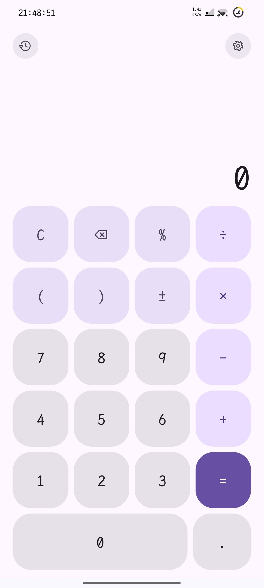
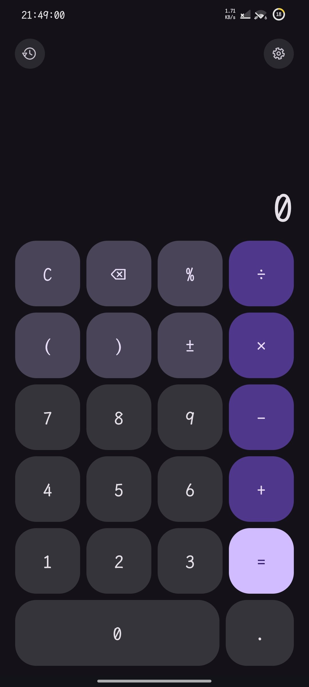
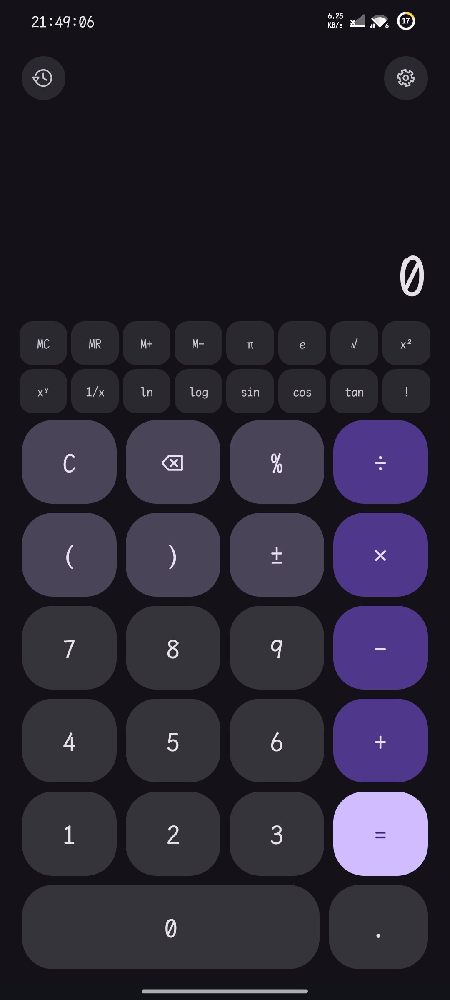

# 计算器（HelloApp）


[](https://github.com/xiaoqi7671/bigdecimal-calculator/releases)

单 Activity 的 Android 计算器，零第三方依赖，界面全部用系统 View 代码搭建（无 XML 布局、无 Compose）。

## 截图

<p align="center">
  
  
  
</p>

## 结构

| 文件 | 作用 |
| --- | --- |
| `app/src/main/kotlin/com/xiaoqi/calculator/Calculator.kt` | 表达式引擎：四则、括号、一元负号、后缀百分号；纯 Kotlin，可脱离 Android 编译 |
| `app/src/main/kotlin/com/xiaoqi/calculator/MainActivity.kt` | 界面与按键状态机 |
| `tools/EngineCheck.kt` | 引擎自检（50 条断言），`kotlinc` 直接跑，CI 也会跑 |
| `design/icon.svg`、`design/icon-round.svg` | 图标设计源文件 |
| `keystore/` | 本地签名材料（**不入库**，需自行备份 `.p12` 与口令） |

## 构建

```bash
gradle assembleDebug     # 调试包
gradle assembleRelease   # 签名发布包
```

`gradle.properties` 里的 `android.aapt2FromMavenOverride` 指向本机 `build-tools`，换机器要改。
`keystore/keystore.properties` 提供签名口令，不在版本库内。

## 引擎自检

```bash
kotlinc app/src/main/kotlin/com/xiaoqi/calculator/Calculator.kt tools/EngineCheck.kt \
        -include-runtime -d .check/engine.jar
java -jar .check/engine.jar
```

## Material 3

- 依赖 `com.google.android.material:material:1.13.0` + `androidx.appcompat:appcompat:1.7.0`；
- 主题 `Theme.Material3.DayNight.NoActionBar`，跟随系统深浅色（`values/` 与 `values-night/` 两套状态栏设置）；
- Android 12+ 由 `DynamicColors` 跟随壁纸取色，12 以下回退 Material 3 默认配色；
- 键位色板：数字 = `surfaceContainerHighest`，运算符 = `primaryContainer`，`=` = `primary`，功能键 = `secondaryContainer`，圆角 28dp；
- 历史面板 = `BottomSheetDialog` 底部抽屉（拖拽把手 + 圆角行），清空用 `MaterialAlertDialogBuilder`。

## 顶栏与设置

- 顶栏高 48dp：左「历史」、右「设置」两个 40dp 圆底描边图标（触摸热区 48dp），中间弹性区留空，后续放单位换算/科学模式等栏位；
- 历史记录改为点击图标打开底部抽屉，顶栏不再显示最近一条；
- 设置抽屉（`BottomSheetDialog`）三项：
  - **百分比按相对值计算**（默认开）：开 `200+10% = 220`，关 `200+10% = 200.1`；
  - **连按等号重复上次运算**（默认开）：`2+3=` 得 5，再按 `=` 得 8；
  - **科学模式**（占位，暂未实现）；
- 边距由 `WindowInsets` 处理（Android 15 强制 edge-to-edge），横屏/挖孔/手势条都吃 inset；
- 开启预测式返回：抽屉打开时返回键先关抽屉。

## 历史记录

- 按 `=` 记录「算式 + 结果 + 年月日」；
- 输入中途停手 15 秒，会把半成品算式记一条「停留记录」（结果栏显示预览值或 `未完成`）；
- 顶部横条显示最近一条，点开是历史面板；
- 面板里点一条 → 把该算式放回输入框继续算；
- 长按一条 → 复制 `算式 = 结果`；
- 长按结果区 → 菜单（复制表达式 / 粘贴 / 清空），粘贴会自动过滤非法字符并统一运算符。

## 行为约定

- 屏幕上**只显示用户输入的表达式**，按下 `=` 之后才显示计算结果，历史行显示 `表达式 =`。
- 转屏保留当前表达式与历史行。
- 长按 `⌫` 清空全部。
- 支持外接键盘：数字、`+ - * /`、回车（=）、Esc（C）、Backspace。

## 签名

版本：`2.2-test`（versionCode 5）— 顶栏图标入口 / 设置抽屉 / 百分比模式

`com.xiaoqi.calculator`，自签名证书 `CN=Xiaoqi Calculator`，
SHA-256 `0594d3e9934c4ff424c55eb73f33dcc7ff528f1534bf970a20ca1181481999be`。

## 大数与精度（2.3-test）

引擎从 `Double` 换成 `BigDecimal`，规则如下：

| 项目 | 规则 |
|---|---|
| 有效数字 | 34 位（`MathContext(34, HALF_EVEN)`，即 DECIMAL128） |
| 输入位数 | 超过 34 位有效数字的部分会被舍入，不会报错 |
| 显示阈值 | 整数 34 位以内原样显示；再长、或绝对值低于 `1e-10`，转科学记数法（尾数保留 34 位） |
| 上下限 | `|x| < 10^1001`；`10^1000` 可算，`10^1001` 报「结果超出范围」 |
| 超越函数 | `sin/cos/tan/ln/log/√` 内部走 double，结果按 15 位有效数字收敛；三角函数按**角度**（`sin(30)=0.5`） |
| 幂 | 整数指数用 `BigDecimal.pow`（精确到 34 位）；小数指数走 double，15 位 |

自检：`tools/EngineCheck.kt`（48 条，含 `2^100`、`2^53+1`、`1E-10` 解析、隐式乘法 `2π`、`3√4`）。

## 科学键与记忆（2.3-test）

设置里打开「科学模式」后，键盘上方出现两行功能键：

```
MC  MR  M+  M−  π  e  √  x²
xʸ  1/x ln  log sin cos tan !
```

- 记忆寄存器用 `BigDecimal`，顶栏中间显示 `M <值>`，点它等于 `MR`；
- `1/x` 把当前整个算式包进 `1÷( )`；
- `x²` 追加 `^2`，`xʸ` 追加 `^`，`!` 追加阶乘；
- 输入受限 64 字符（`Calculator.MAX_LENGTH`）。

## 许可证

Copyright (C) 2026 xiaoqi7671

本项目以 **GNU General Public License v3.0** 发布，完整条款见 [LICENSE](LICENSE)。
你可以自由使用、修改、再分发，但衍生作品必须以同样的许可证开源。

## 常见问题

**push 时提示 403 或连接超时？** 如果你的 `~/.gitconfig` 里有

```
url.https://gh-proxy.org/https://github.com/.insteadOf https://github.com/
```

`git remote -v` 会显示被改写过的地址，`git push` 也会被带去代理。显式写原地址并锁 HTTP/1.1 即可：

```bash
git -c http.version=HTTP/1.1 push https://github.com/<owner>/<repo>.git main
```

**构建报 `Could not initialize native services`？** 让 Gradle 能写 `~/.gradle`（在受限环境中需要放宽文件权限），或者用 `--offline` 复用已有缓存。

**装 APK 报 `Can't open file: /sdcard/...`？** 部分系统上 `system_server` 读不到 fuse 共享存储，改用文件管理器点安装，或先 `cp` 到 `/data/local/tmp` 再 `pm install`。

## 下载

- [Releases](https://github.com/xiaoqi7671/bigdecimal-calculator/releases)：直接下 `.apk` 安装（当前 `2.3-test`，5.17 MB，minSdk 34）
- 或者本地构建：`gradle --offline --console=plain assembleRelease`（需要 Android SDK 与 JDK 21）

## 贡献者

| 贡献者 | 角色 |
|---|---|
| **xiaoqi7671** | 产品方向、需求拆解、真机验收、发布签名密钥 |
| **DeepSeek Harness**（AI 代理） | 引擎、界面、图标、自检脚本、构建与发版 |

代码由 AI 代理在用户逐条需求的指导下编写，功能取舍与验收由用户完成；
提交历史里的 `Co-authored-by` 记录了这个协作过程。
